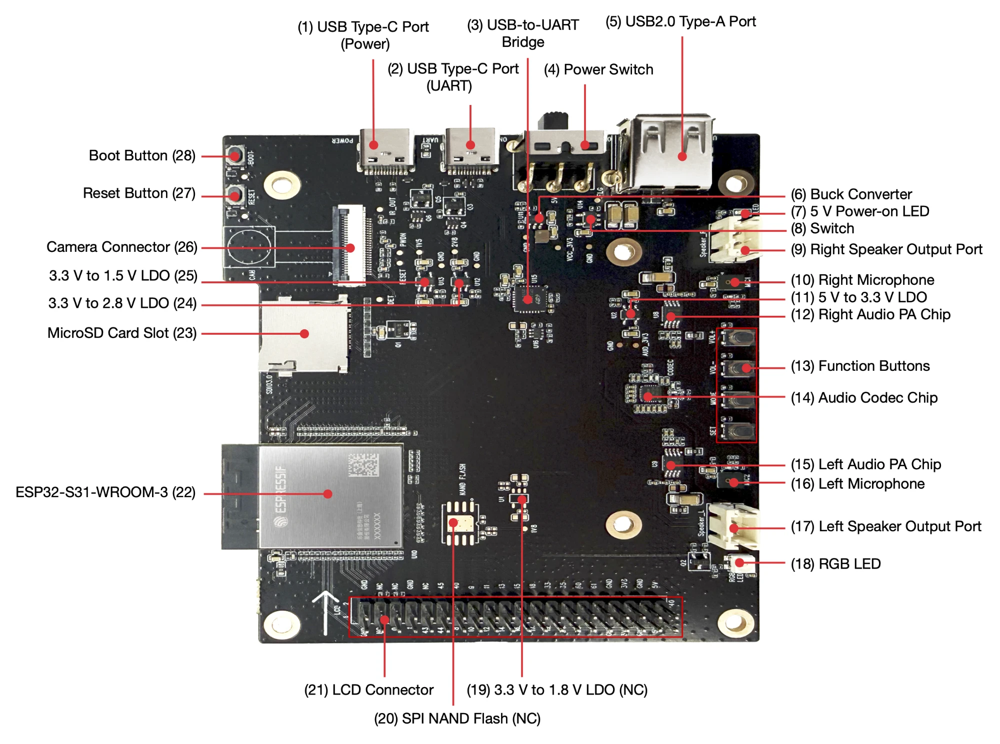
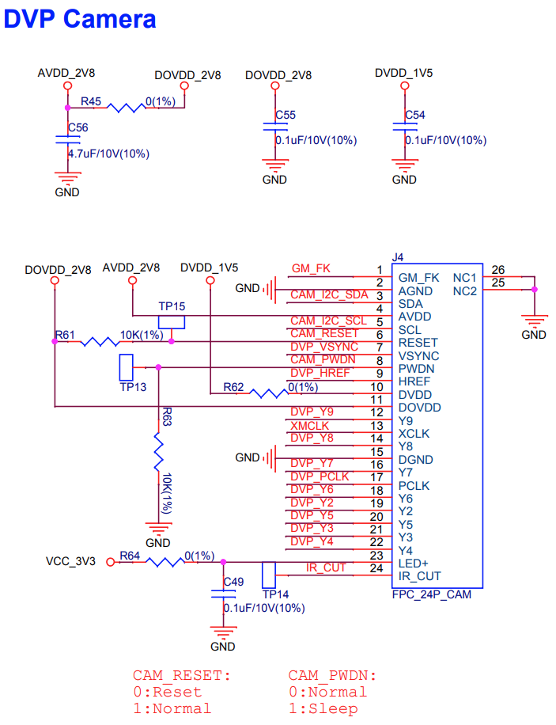

# ESP32-S31-Korvo-1 DVP 카메라 웹 스트리밍

ESP32-S31-Korvo-1 보드의 DVP 카메라 영상을 Wi-Fi(STA)로 보내는 MJPEG 웹 스트리밍 펌웨어다.
브라우저에서 `http://<보드 IP>/`를 열면 영상을 보고 해상도와 센서 설정을 바꿀 수 있다.



## 장착된 카메라 모듈

이 보드에는 SmartSens **SC101IOT**가 달려 있다(부팅 로그의 칩 ID `0xda4a`로 확인).
같은 Korvo-1이라도 OV3660(3 MP)이 달린 보드가 있으며, 펌웨어는 두 센서를 모두 자동으로 감지한다.

| 항목 | 내용 |
|---|---|
| 센서 | SmartSens SC101IOT, 1 MP |
| 최대 해상도 | 1280 × 720 |
| 광학 포맷 | 1/4.2" |
| 인터페이스 | DVP 8비트, XCLK 20 MHz |
| 출력 | YUV422(UYVY). S31 하드웨어 JPEG 인코더로 압축한다 |
| SCCB 주소 | 0x68 |
| 쓸 수 있는 모드 | 1280 × 720 25 fps, 640 × 480 15 fps |

640 × 480 모드는 1280 × 720 15 fps 모드의 가운데를 잘라낸 것이라 15 fps까지만 나온다.

## 카메라 커넥터 (J4, 24핀 FPC)



- 전원: AVDD 2.8 V, DOVDD 2.8 V, DVDD 1.5 V
- CAM_RESET은 10 kΩ 풀업, CAM_PWDN은 10 kΩ 풀다운으로 고정되어 GPIO로 제어하지 않는다.
- 1~22번 핀은 ESP32-CAM 계열 24핀 표준과 같다. 23번(LED+)에는 R64를 거쳐 3.3 V가 들어간다.
  23·24번이 Y1·Y0인 일반 OV3660 모듈을 쓰려면 R64를 떼야 한다.

## 빌드와 플래시

ESP-IDF v6.1이 필요하다.

```bash
idf.py build
idf.py -p COMx flash monitor
```

## 사용법

1. 처음 부팅하면 시리얼 콘솔(UART용 USB-C 포트, 115200 bps)에서 Wi-Fi SSID와 비밀번호를 입력한다.
   값은 NVS에 저장되므로 다음 부팅부터는 묻지 않는다.
2. 콘솔에 나온 IP로 `http://<IP>/`를 연다.

콘솔 명령: `status`, `wifi`, `wifi_reset`(저장한 Wi-Fi 정보를 지우고 재부팅), `restart`

| 주소 | 기능 |
|---|---|
| `/` | 웹 페이지 (영상, 해상도·센서 설정, 상태) |
| `/stream` | MJPEG 스트림 (동시 접속 최대 2개) |
| `/capture` | JPEG 한 장 |
| `/status` | 상태 JSON |
| `/control?var=resolution&val=1280x720` | 해상도 전환 (약 0.7초, 스트림은 끊기지 않음) |
| `/control?var=<이름>&val=<값>` | 센서 설정 (quality, hmirror, vflip 등) |

부팅할 때 해상도는 menuconfig의 `DVP Web Camera → Camera → Stream resolution` 값(기본 640 × 480)을 쓴다.

## 알려진 문제

ESP-IDF v6.1에서 ESP32-S31의 `esp_restart()`는 CPU만 리셋하고 주변장치는 리셋하지 않는다(IDF-14841).
펌웨어는 재시작 직전에 카메라와 DMA를 멈춰 이 문제를 피한다.
panic이나 워치독으로 리셋되면 이 처리를 거치지 않으므로, 카메라가 멈추면 전원을 다시 넣거나 RESET 버튼을 누른다.

---
이미지 출처: Espressif ESP32-S31-Korvo-1 사용자 가이드와 회로도
